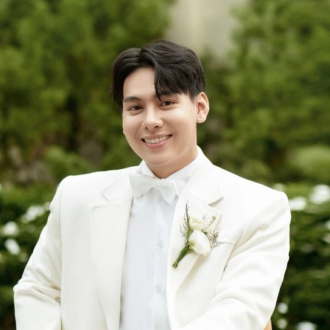
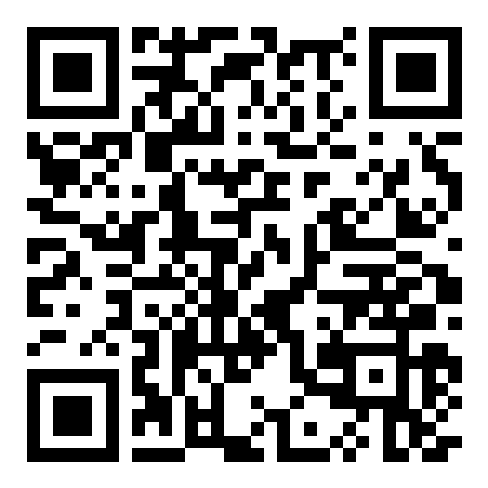

# Nội dung thiệp cưới

Sửa nội dung dưới tiêu đề, lưu tệp rồi nhấn F5. Giữ nguyên các tiêu đề tiếng Việt để website nhận biết từng mục.

- **Ảnh cô dâu, chú rể và album:** đặt trong thư mục `anh-cuoi`, cùng vị trí với tệp này. Ví dụ: ``.
- **Nhạc và ảnh QR:** đặt trong thư mục `asset`.
- Cụm `{{Tên chú rể}}` lấy nội dung từ mục cùng tên, bạn có thể giữ nguyên hoặc thay bằng chữ riêng.
- Ngày nhập dạng `2027-12-20`; giờ nhập dạng `18:00`. Ngày âm lịch nhập riêng.
- `true` là bật, `false` là tắt. Liên kết `tu-dong` được tạo từ địa điểm và ngày giờ tiệc cưới.
- Khi đổi tài khoản ngân hàng, cần thay ảnh QR tương ứng.
- Thêm hoặc xóa dòng bảng để chỉnh album và lịch trình. Dùng `\|` để viết ký tự `|` trong ô.

## Ẩn hoặc hiện các phần

Đổi thành `false` để ẩn toàn bộ phần tương ứng, hoặc `true` để hiện.

### Hiện album ảnh

true

### Hiện xác nhận tham dự

true

### Hiện bản đồ và nút chỉ đường

true

### Hiện dress code

false

### Hiện lịch trình

false

### Hiện sổ lưu bút

true

### Hiện hộp quà mừng

true

## Cô dâu và chú rể

### Tên chú rể

Minh Đức

### Họ và tên chú rể

Phùng Minh Đức

### Vai vế của chú rể trong gia đình

Thứ Nam

### Tên cô dâu

Trang Nhung

### Họ và tên cô dâu

Nguyễn Trang Nhung

### Vai vế của cô dâu trong gia đình

Thứ Nữ

## Thông tin hai gia đình

### Họ và tên bố chú rể

Phùng Văn Phẩm

### Họ và tên mẹ chú rể

Lê Thị Liền

### Địa chỉ nhà trai

Số nhà 15, Đường Quảng Đại, Tổ dân phố Thanh Mỹ, Phường Tùng Thiện, Hà Nội

### Họ và tên bố cô dâu

Nguyễn Phi Hùng

### Họ và tên mẹ cô dâu

Vũ Thị Thanh Thủy

### Địa chỉ nhà gái

Số nhà 28/117, Đường Trung Sơn Trầm, Phường Tùng Thiện, Hà Nội

## Lễ cưới và tiệc cưới

### Ngày tổ chức lễ cưới

2027-12-20

### Giờ tổ chức lễ cưới

09:00

### Ngày âm lịch của lễ cưới

Tức ngày 8 tháng 4 năm Bính Ngọ

### Nơi cử hành lễ cưới

LỄ THÀNH HÔN ĐƯỢC CỬ HÀNH TẠI
TƯ GIA

### Ngày tổ chức tiệc cưới

2027-12-20

### Giờ bắt đầu tiệc cưới

18:00

### Giờ kết thúc tiệc cưới

20:00

### Giờ đón khách dự tiệc

17:30

### Ngày âm lịch của tiệc cưới

Tức ngày 12 tháng 11 năm Đinh Mùi

### Địa điểm và địa chỉ tổ chức tiệc cưới

Tư gia nhà trai — Số nhà 15, Đường Quảng Đại, Tổ dân phố Thanh Mỹ, Phường Tùng Thiện, Hà Nội

## Lời mời và lời cảm ơn

### Lời chào trên bìa thiệp

Thân Mời

### Lời mời dự lễ cưới

TRÂN TRỌNG BÁO TIN
LỄ THÀNH HÔN CỦA CON CHÚNG TÔI

### Lời cảm ơn cuối thiệp

Sự hiện diện của quý khách là niềm vinh hạnh của gia đình chúng tôi!

### Lời nhắn về trang phục dự tiệc

Trang phục dự tiệc

## Ảnh chân dung

### Ảnh chân dung chú rể

### Ảnh chân dung cô dâu

## Nhạc nền và liên kết

### Link Google Maps

https://maps.app.goo.gl/AfuoxgLrJZXaKEME7

### Liên kết thêm sự kiện vào lịch

### Liên kết trò chuyện

### Bật hoặc tắt nút trò chuyện

### Bật hoặc tắt nhạc nền

true

### Tệp nhạc nền của thiệp

## Tài khoản và mã QR nhận quà

### Tên ngân hàng của chú rể

Vietcombank

### Số tài khoản ngân hàng của chú rể

0000000000

### Tên chủ tài khoản của chú rể

THIEP CUOI DEMO

### Tên ngân hàng của cô dâu

BIDV

### Số tài khoản ngân hàng của cô dâu

6665558888

### Tên chủ tài khoản của cô dâu

{{Họ và tên cô dâu}}

### Ảnh mã QR nhận quà của chú rể

### Ảnh mã QR nhận quà của cô dâu

## Album ảnh

| Ảnh | Mô tả | Vị trí ảnh |
| --- | --- | --- |
| ./anh-cuoi/album-1.webp | Wedding photo 1 | 50% 50% |
| ./anh-cuoi/album-2.webp | Wedding photo 2 | 50% 21.182266009852217% |
| ./anh-cuoi/album-3.webp | Wedding photo 3 | 50% 50% |
| ./anh-cuoi/album-4.webp | Wedding photo 4 | 50% 50% |
| ./anh-cuoi/album-5.webp | Wedding photo 5 | 50% 99.99999999999999% |
| ./anh-cuoi/album-6.webp | Wedding photo 6 | 50% 50.738916256157616% |
| ./anh-cuoi/album-7.webp | Wedding photo 7 | 50% 50% |
| ./anh-cuoi/album-8.webp | Wedding photo 8 | 50% 0% |

## Lịch trình

| Giờ | Hoạt động |
| --- | --- |
| 17:30 | Đón khách |
| 18:30 | Khai tiệc |
| 18:45 | Rót rượu, cắt bánh |
| 19:00 | Phục vụ món chính |
| 21:00 | Kết thúc tiệc |

## Màu trang phục

| Màu |
| --- |
| #224327 |
| #4a6b4f |
| #c2e3c7 |
